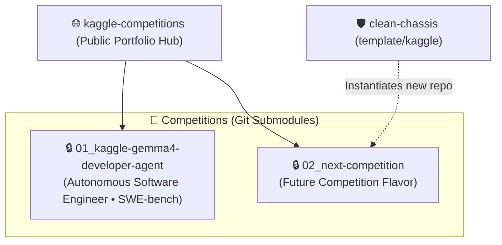

# 🏆 Kaggle Competitions Portfolio & AI Engineering Hub

[](https://www.kaggle.com/rogeriolopesdasilva)
[](https://github.com/RogerioLS/clean-chassis)
[](https://git-scm.com/book/en/v2/Git-Tools-Submodules)
[](LICENSE)

> **Centralized competition portfolio, benchmark tracking, and architecture showcase for competitive Machine Learning, Large Language Models, and Autonomous Engineering Agents.**

---

## 🏛️ Ecosystem Architecture

This repository operates as a **Federated Portfolio Hub** aggregating competitive repositories via **Git Submodules**:



- 🔒 **IP Protection During Competitions**: Active competition repositories remain private to safeguard proprietary model weights, prompts, and inference pipelines.
- 🌐 **Public Tracking & Transparency**: External visitors view the chronological index and project architectures without compromising proprietary competition strategies.
- 🔓 **Post-Competition Open Source**: Completed challenges can be made public with zero structural changes to the hub.

---

## 📋 Competition Index

| # | Competition | Domain / Task | Core Stack | Status | Submodule Pointer |
|---|---|---|---|---|---|
| **01** | [Gemma 4 Developer Agent](https://www.kaggle.com/competitions/gemma-4-developer-agent) | Autonomous Software Agent (SWE-bench) | Gemma 4 31B, vLLM Quad-L4, LoRA W4A16, ReAct | 🚀 Active | [`01_kaggle-gemma4-developer-agent`](01_kaggle-gemma4-developer-agent) |

---

## 🚀 Cloning & Development

### Clone with all Submodules (Authorized Contributors)
```bash
git clone --recurse-submodules git@github.com:RogerioLS/kaggle-competitions.git
```

### Initialize Submodules in an Existing Clone
```bash
git submodule update --init --recursive
```

### Updating Submodule References
To update a submodule to its latest remote commit:
```bash
git submodule update --remote --merge
```

---

## 🛠️ Adding a New Competition

New competitions are scaffolded directly from the official **Clean Chassis (Kaggle Flavor)**:

```bash
# 1. Instantiate from the Clean Chassis Kaggle flavor
git clone -b template/kaggle git@github.com:RogerioLS/clean-chassis.git 02_nome-da-competicao
cd 02_nome-da-competicao
git checkout -B main

# 2. Push to your new private repository on GitHub
git remote set-url origin git@github.com:RogerioLS/02_nome-da-competicao.git
git push -u origin main

# 3. Register as a submodule in this hub
cd ../kaggle-competitions
git submodule add git@github.com:RogerioLS/02_nome-da-competicao.git 02_nome-da-competicao
git commit -m "feat(hub): [INFRA] register 02_nome-da-competicao submodule"
git push origin main
```

---

## ⚖️ License

Portfolio hub documentation distributed under the MIT License. See [LICENSE](LICENSE) for details. Submodule contents are governed by their respective repository licenses.
